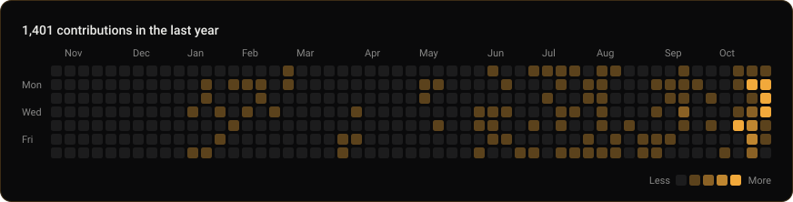

# GitHub Reskin

Themes for GitHub. Click the extension, pick a theme or set your own colors, and every open GitHub tab repaints. That includes the contribution graph, which normally stays green or switches to whatever GitHub picks for a holiday.

There's also a GitHub Action that draws your contribution graph as an SVG for your profile README, so visitors see your colors too.



## The extension

Twelve themes come with it. The dark ones are Editing Suite, Dracula, Nord, Catppuccin Mocha, Gruvbox, Tokyo Night, Rosé Pine, One Dark and Solarized Dark. The light ones are Catppuccin Latte, Rosé Pine Dawn and Solarized Light.

Under the themes are four colors you can change: background, text, accent and the contribution graph. GitHub Reskin works out the rest, like borders, muted text and button colors. If a muted text or link color would be hard to read on your background, GitHub Reskin nudges it toward your text color until it passes WCAG AA contrast. If your text color itself is hard to read, the card warns you and the derived colors use black or white instead. "Reset to theme" puts the theme's colors back. The switch at the top turns the theme off.

It recolors github.com and gist.github.com through the color variables GitHub's own CSS uses. A dark theme also brings in GitHub's dark colors for code, diffs and labels, and a light theme brings the light ones, so code stays readable whichever mode your GitHub account is set to. It stores your settings in the browser and makes no network requests. To avoid a flash of GitHub's colors on a full page load, it also caches the generated CSS in github.com's local storage.

### Install

The extension isn't in the Chrome Web Store or on Firefox Add-ons yet. To load it from this repo:

1. Download the repo (Code, then Download ZIP) and unzip it.
2. Chrome, Edge, Brave or Arc: open `chrome://extensions`, turn on Developer mode, click Load unpacked and pick the `extension` folder.
3. Firefox: open `about:debugging#/runtime/this-firefox`, click Load Temporary Add-on and pick `extension/manifest.json`. Firefox drops temporary add-ons when it restarts.

### Add a theme

Themes live in [`extension/themes.js`](extension/themes.js). A theme needs an `id`, a `name` and four colors: `bg`, `text`, `accent` and `graph`. You can also give `surface`, `border` and `muted` if the original palette has them. `node --test` checks that every theme keeps its text readable.

GitHub's light and dark colors live in `extension/github-modes.js`. If GitHub changes them, `node scripts/github-modes.mjs` rebuilds that file from github.com's current CSS.

## The profile graph

The extension only changes what you see. To show your colors to everyone who visits your profile, add this workflow to your profile repo, the one named after you, like `you/you`. Save it as `.github/workflows/contributions.yml`:

```yaml
name: Contribution graph

on:
  schedule:
    - cron: "17 6 * * *"
  workflow_dispatch:

permissions:
  contents: write

jobs:
  update:
    runs-on: ubuntu-latest
    steps:
      - uses: actions/checkout@v5

      - uses: Alitleis123/GitHub-Reskin@v1
        with:
          output: assets/contributions.svg
          color: "#f2a93b"

      - name: Commit if changed
        run: |
          git add assets/contributions.svg
          if git diff --cached --quiet; then exit 0; fi
          git config user.name "github-actions[bot]"
          git config user.email "41898282+github-actions[bot]@users.noreply.github.com"
          git commit -m "Refresh contribution graph [skip ci]"
          git pull --rebase
          git push
```

Run it once from the Actions tab, then put this in your README:

```html

```

It redraws every morning from the same calendar GitHub uses, through the GraphQL API, so busy and quiet days shade the way they do on your profile. GitHub still shows its own graph under your README, since there's no setting to hide it.

| Input | Default | What it does |
| --- | --- | --- |
| `username` | owner of the repo | Whose graph to draw. Set this when the repo belongs to an organization. |
| `color` | `#f2a93b` | Color of the busiest days. Quieter days get fainter mixes of it. |
| `background` | `#0a0a0b` | Panel color |
| `text` | `#ededea` | Text color. Empty days and labels are mixed from it. |
| `output` | `contributions.svg` | Where the SVG goes |
| `token` | the workflow token | Token for the GraphQL API |

Colors are 6-digit hex. With the default workflow token, the graph shows what visitors see on your profile. That includes private contributions as plain counts if you turned on "Include private contributions on my profile" in your GitHub settings.

To run it on your own computer, you need Node 20 or newer and a GitHub token. With the GitHub CLI:

```sh
GITHUB_TOKEN=$(gh auth token) node index.mjs --username you --color "#7c5cff" --output contributions.svg
```

## Theme credits

The theme palettes come from these MIT-licensed projects:

- [Dracula](https://draculatheme.com)
- [Nord](https://www.nordtheme.com)
- [Catppuccin](https://catppuccin.com)
- [Gruvbox](https://github.com/morhetz/gruvbox)
- [Tokyo Night](https://github.com/enkia/tokyo-night-vscode-theme)
- [Rosé Pine](https://rosepinetheme.com)
- [One Dark](https://github.com/atom/atom/tree/master/packages/one-dark-syntax)
- [Solarized](https://ethanschoonover.com/solarized/)

Editing Suite is the amber and near-black from [my profile](https://github.com/Alitleis123).

## License

MIT
